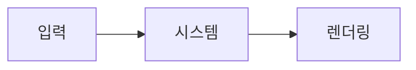
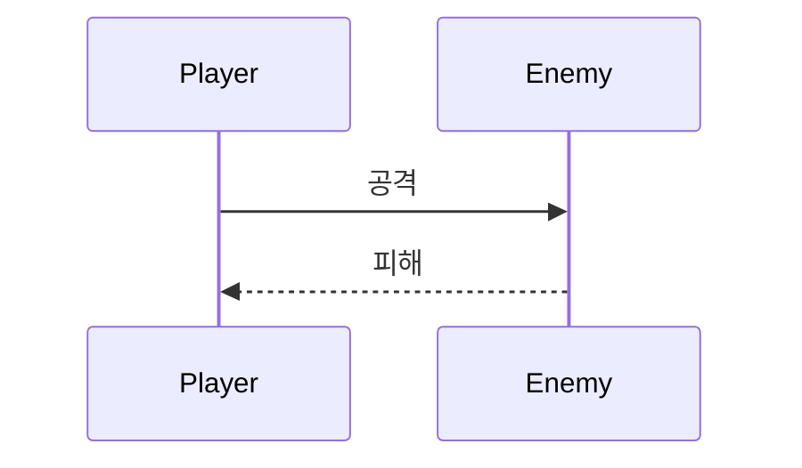
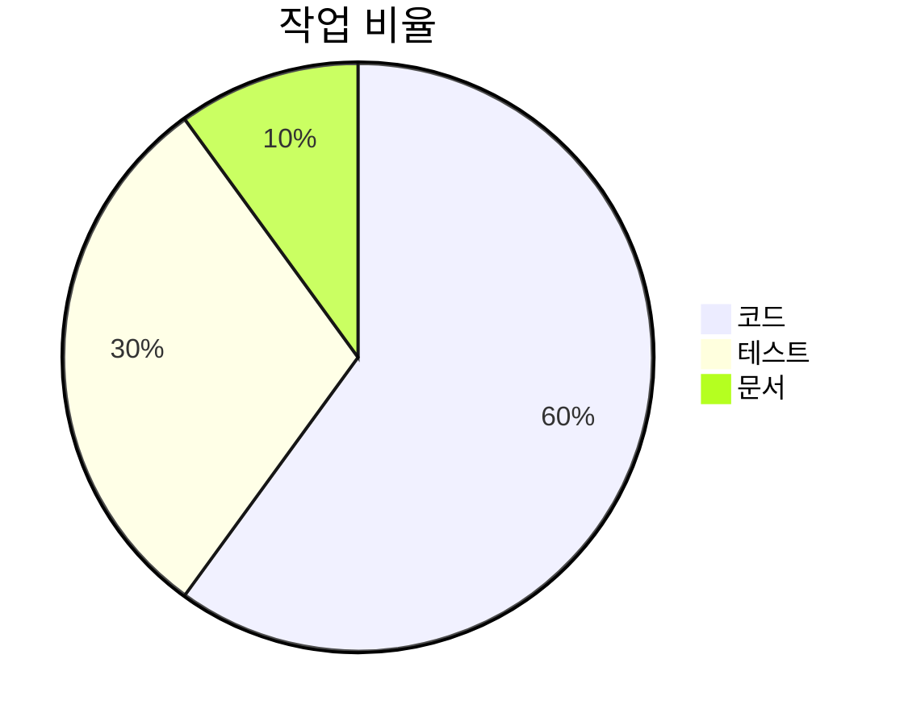
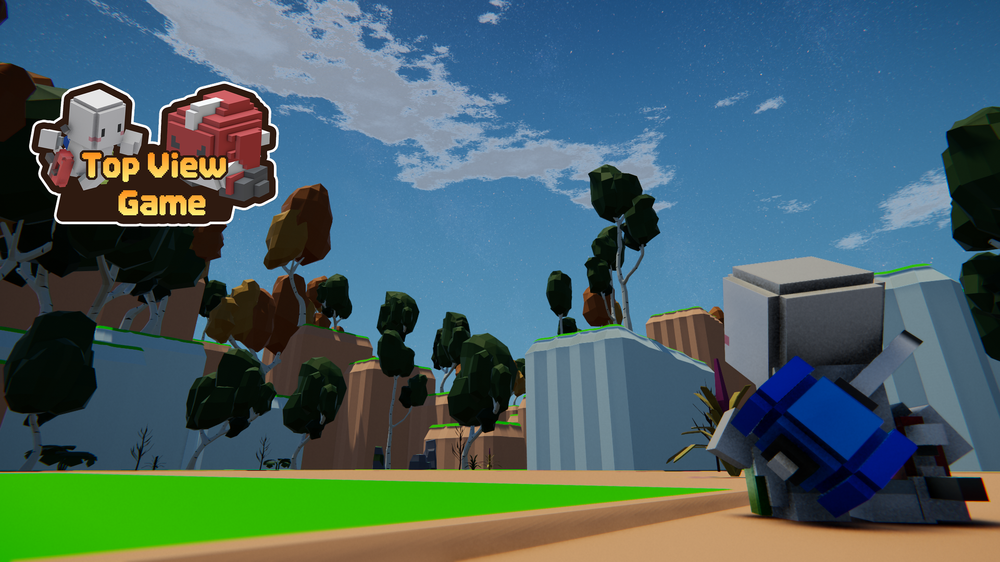

# 제목 1
## 제목 2
### 제목 3
#### 제목 4

---

## 글자 꾸미기
**굵게** · *기울임* · ***굵게 기울임*** · ~~취소선~~ · `인라인 코드`
<sup>위첨자</sup> · <sub>아래첨자</sub> · <ins>밑줄</ins> · <mark>형광펜</mark>(GitHub에서 안 될 수 있음)
<kbd>Ctrl</kbd> + <kbd>S</kbd> · <kbd>W</kbd><kbd>A</kbd><kbd>S</kbd><kbd>D</kbd>
줄 끝에서<br>강제로 줄바꿈

## 알림 상자
> [!NOTE]
> 설명

> [!TIP]
> 팁

> [!IMPORTANT]
> 중요

> [!WARNING]
> 주의

> [!CAUTION]
> 위험

## 인용문
> 한 단계 인용
>> 두 단계 인용

## 접기
<details>
<summary>닫힌 상태로 시작</summary>

접힌 내용. **마크다운도 됩니다.** 위아래로 빈 줄을 두어야 합니다.

</details>

<details open>
<summary>열린 상태로 시작</summary>

처음부터 펼쳐져 있습니다.

</details>

## 목록
- 순서 없는 목록
  - 들여쓴 목록
1. 순서 있는 목록
2. 두 번째

- [x] 끝난 일
- [ ] 남은 일

## 표
| 왼쪽 정렬 | 가운데 정렬 | 오른쪽 정렬 |
|:---|:---:|---:|
| 이동 | <kbd>WASD</kbd> | 1 |
| 공격 | 마우스 왼쪽 | 2 |

## 코드
```csharp
public sealed class Player : MonoBehaviour
{
    void Update() { }
}
```

```diff
- 지운 줄
+ 더한 줄
```

## 수식
인라인 수식 $v = \frac{d}{t}$

$$
x_{t+1} = x_t + v \cdot \Delta t
$$

$\color{red}{\text{빨간 글자(수식 우회)}}$

## 다이어그램 (Mermaid)






## 지도와 3D (코드 블록)
```geojson
{ "type": "Point", "coordinates": [126.97, 37.56] }
```

```stl
solid cube
  facet normal 0 0 1
    outer loop
      vertex 0 0 0
      vertex 1 0 0
      vertex 0 1 0
    endloop
  endfacet
endsolid
```

## 링크
[일반 링크](https://github.com) · <https://github.com> · [제목으로 이동](#표) · [저장소 안 파일](Docs/Image/YouTube_Thumbnail.png)

## 각주
각주가 붙은 문장[^1]

[^1]: 각주 내용은 맨 아래에 나옵니다.

## 이미지



<p align="center">
  
  
</p>

[](https://youtu.be/7fyoxN1xmZw)

## 라이트·다크 모드 이미지 따로 두기
<picture>
  <source media="(prefers-color-scheme: dark)" srcset="Docs/Image/download_24dp_8B949E_FILL0_wght400_GRAD0_opsz24.svg">
  
</picture>

## 배지 (shields.io)


## 가운데 정렬
<div align="center">

**가운데 정렬된 글**

</div>

## 주석 (화면에 안 보임)
<!-- 이 글은 README에 보이지 않습니다 -->