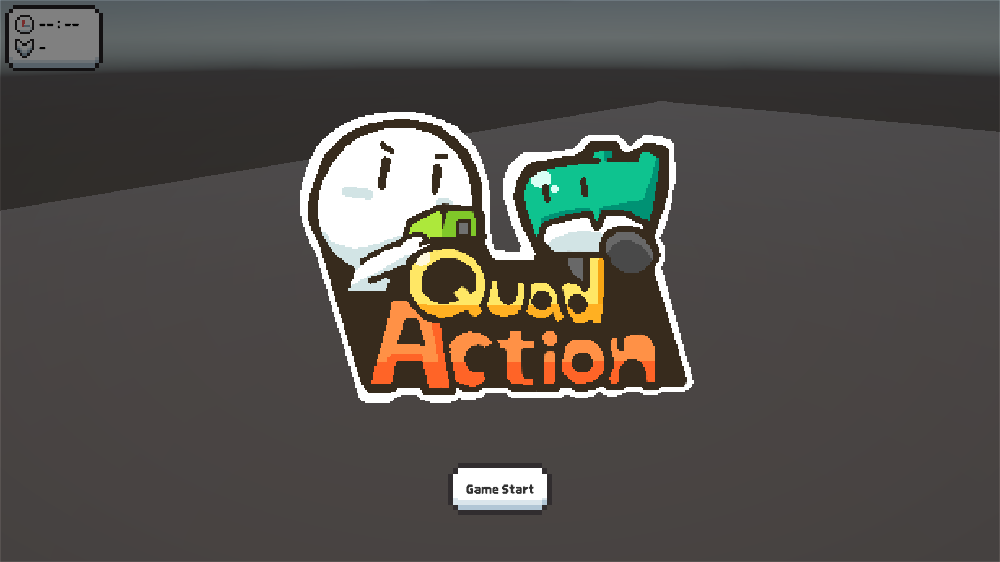

# TopView Game

TopView 싱글플레이 액션 게임입니다.

[Release](https://github.com/To-steak/TopView-Game/releases)에서 다운로드해 직접 플레이해 보실 수 있습니다.
- FSM(Finite State Machine): Player/Enemy/Boss의 행동을 IDLE, MOVE, ATTACK 등의 상태로 분리해 객체로 관리하였습니다. `if-else` 분기에 영향을 받지 않고 상태마다 수행 로직을 관리할 수 있습니다. 
- Mediator: Player/Enemy/Boss가 하위 컴포넌트(Input, Health, Weapon 등)을 직접 참조하지 않고 Mediator를 거쳐서 컴포넌트간의 결합도를 낮추고 의존성을 한 곳에서 관리하였습니다.
- Observer: `GameEvenets`, `PlayerEvents` 등 같은 이벤트를 발행 및 구독하는 형태로 UI나 `GameManager`가 내부 구조를 몰라도 반응할 수 있도록 설계했습니다.
- Scriptable Object: `EnemySO`, `PlayerSO`, `WeaponSO` 등으로 수치와 로직을 분리해 코드 수정 없이 에디터에서 데이터를 조정하고 재사용할 수 있도록 하였습니다.
- Custom Editor: 앞서 만든 Scriptable Object를 통합 관리하는 Custom Editor를 만들어 편의성을 확보했습니다.
- MVP: `PlayerPresenter`, `PlayerUI` 등으로 UI 표현과 게임 로직을 분리했습니다.
- Object Pooling: Unity `IObjectPool<T>`를 사용해 Enemy와 UI를 재사용해 반복적인 `Instantiate`/`Destroy`로 인한 GC 부하와 스파이크를 줄이기 위해 도입했습니다.

# Devlog
개발 과정 중 일어난 문제는 [To_steak's Devlog](https://to-steak.github.io/)에 기록하고 있습니다.
- [확장 가능한 무기 아키텍처](https://to-steak.github.io/client/client_01.html)
- [어셈블리 정의](https://to-steak.github.io/client/client_02.html)
- [풀과 애니메이터 변수 초기화](https://to-steak.github.io/client/client_03.html)

# Demo - 아래 이미지 클릭 시 YouTube로 이동합니다

# License
프로젝트에 사용한 아래 에셋들은 [Unity Asset Store](https://assetstore.unity.com/)에서 배포되며, [Unity Asset Store Terms of Service and EULA](https://unity.com/legal/as-terms)에 따라 라이선스가 적용됩니다.
- [Quarter View 3D Action Assets Pack](https://assetstore.unity.com/packages/3d/characters/quarter-view-3d-action-assets-pack-188720) - by [Goldmetal](https://goldmetal.co.kr/)