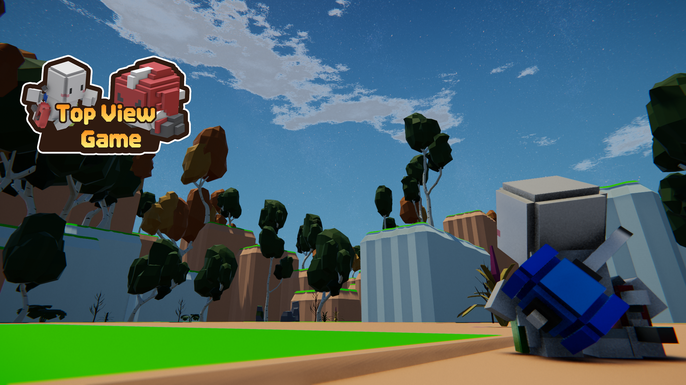
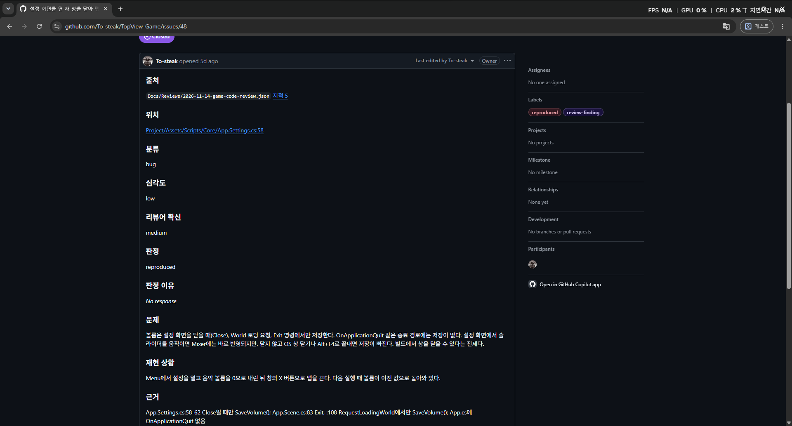
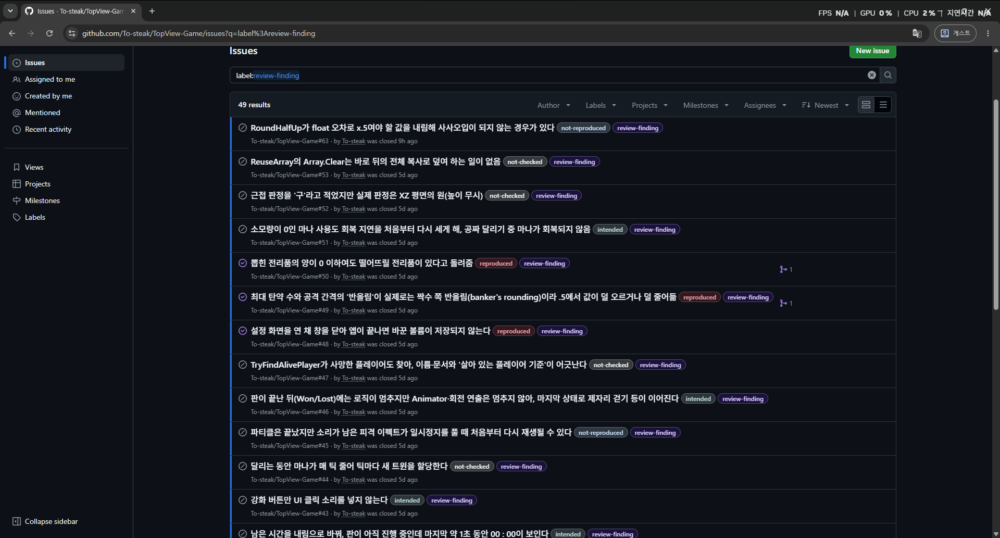
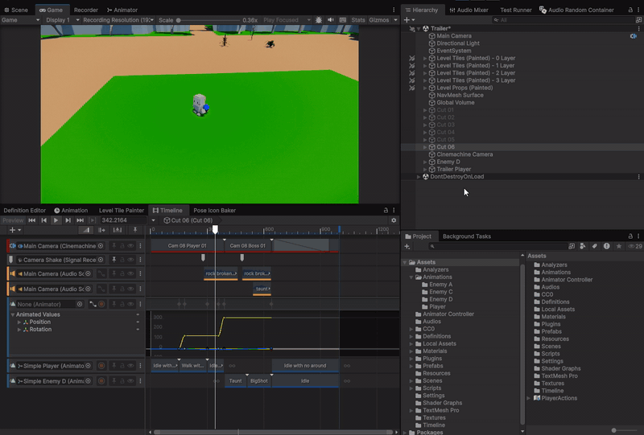
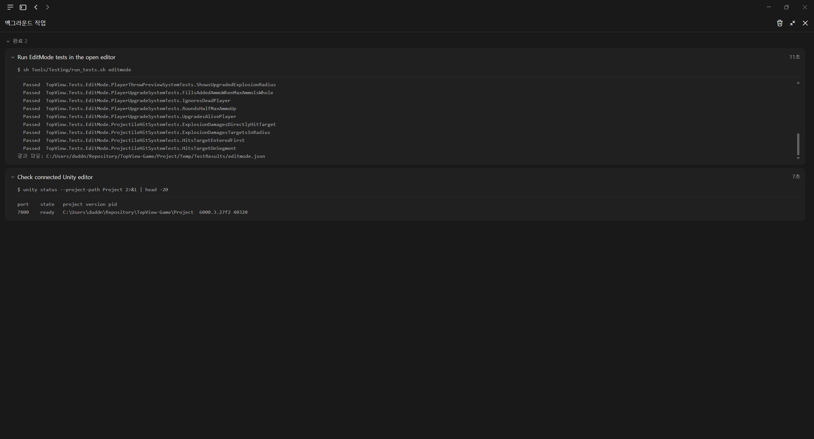
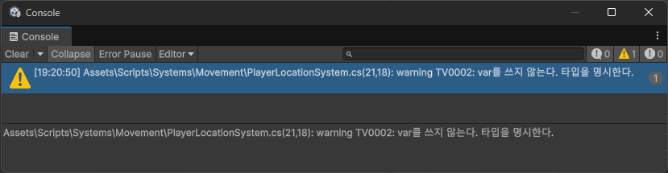
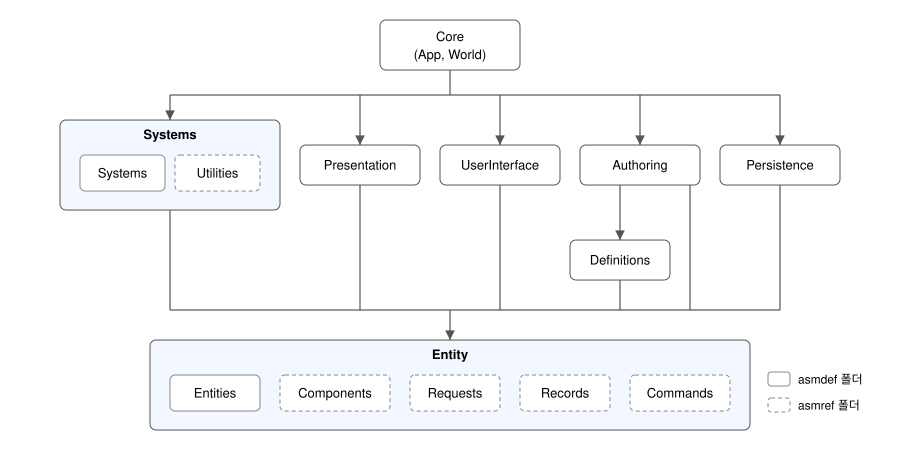
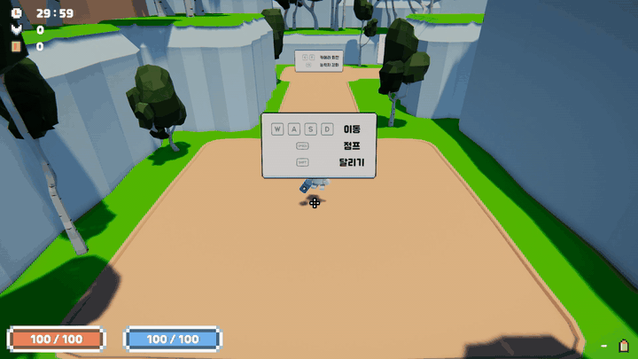

# TopView Game
[](https://youtu.be/7fyoxN1xmZw)

> [!IMPORTANT]
> 적을 물리치고 강화를 하며 최종적으로 보스를 쓰러뜨리는 탑다운 액션 게임을 기획하고 Claude Code와 함께 작업하였습니다.
> 2026년 8월에 올려 두고 멈췄던 프로젝트를, 10월 30일부터 Claude Code와 데이터 지향 구조로 다시 짜서 11월 12일 1.0.0을 출시했습니다.

 [TopView Game 트레일러 영상 보러가기 - YouTube](https://youtu.be/7fyoxN1xmZw)

 [TopView Game 플레이 영상 보러가기 - YouTube](https://youtu.be/7VS9hrIHz_A)

 [다운로드 (Release)](https://github.com/To-steak/TopView-Game/releases)


**Engine**  


**AI**  


**Verification**  


## <a href="#-프로젝트-세-줄-요약"></a> 프로젝트 세 줄 요약
<a href="#-프로젝트-세-줄-요약"></a> **Unity 6으로 탑다운 액션 게임을 팀원 없이 AI(Claude Code)와 함께 기획부터 구현, 트레일러 제작, 배포까지 완성했습니다.**

<a href="#-프로젝트-세-줄-요약"></a> **기획·설계와 플레이 확인은 제가 맡고 구현과 리뷰는 AI(Claude Code)에게 맡겼으며, 그 경계를 규칙 문서([CLAUDE.md](/CLAUDE.md#작업-범위))로 정해 AI가 규칙과 어긋나면 [먼저 묻게](/CLAUDE.md#대화) 했습니다.**

<a href="#-프로젝트-세-줄-요약"></a> **AI가 쓴 코드는 프로젝트 규칙으로 만든 정적 분석기([Roslyn](/Tools/TopView.Analyzers/README.md)), 코드를 작성한 세션과 다른 새 세션의 AI 리뷰([Claude Code Workflow](/Tools/CodeReview/README.md)), 버그 지적의 재현 테스트([Unity Test Framework](/Tools/Testing/README.md))를 거쳐 확인하고, 모든 지적을 판정과 함께 이슈로 기록해 재현된 버그만 열어 두었습니다([GitHub Issues](/Tools/ReviewIssues/README.md)).**

## <a href="#-목차"></a> 목차
- <a href="#-개발-과정"> 개발 과정</a>
- <a href="#-ai가-일할-수-있는-환경"> AI가 일할 수 있는 환경</a>
- <a href="#-검증-체계"> 검증 체계</a>
- <a href="#-기술-구조"> 기술 구조</a>
- <a href="#-저장소-구성"> 저장소 구성</a>
- <a href="#-실행-방법"> 실행 방법</a>
- <a href="#-license"> License</a>

## <a href="#-개발-과정"></a> 개발 과정
자세한 이야기는 [Notion](https://coherent-grade-1bf.notion.site/TopView-Game-41d3fc64bd0380c899bdc6e46f031866)에 있습니다.

<details>
<summary><b>AI와 개발자의 역할 분담</b></summary>

**개발자**
- 프로젝트의 코드 구조를 AI와 함께 설계했습니다([아키텍처 규칙](/.claude/rules/architecture.md)).
- 레벨 디자인(World 씬 지형·소품 배치), UI 제작(메뉴·설정·강화 화면), 이펙트와 사운드 배치를 에디터에서 맡았습니다.
- 직접 플레이해 보고 수치 편집 창으로 게임 내 수치를 조정해 밸런스를 잡았습니다.
- AI의 작업 범위와 규칙을 문서로 정해, 규칙과 어긋나는 지시는 AI가 먼저 되묻게 했습니다([작업 범위](/CLAUDE.md#작업-범위), [되묻기 규칙](/CLAUDE.md#대화), [코드 규칙](/.claude/rules/csharp-style.md)).

 

> 왼쪽은 수치 편집 창으로, Definition 에셋을 Settings·Weapons·Player·Enemy·Loot 탭에 모아 고른 에셋의 수치를 바로 고칩니다. 
>
> 오른쪽은 타일 배치 도구로, 타일·소품·방·채우기·산 모드와 브러시 크기, 층을 골라 씬에 타일을 칠합니다.

**AI(Claude Code)**
- 게임 코드를 작성하고 리뷰했습니다.
- 제가 요청한 대로 [수치 편집 창](/Project/Assets/Scripts/Editor/DefinitionEditorWindow.cs#L6-L7), [타일 배치 도구](/Project/Assets/Scripts/Editor/LevelTilePainterWindow.cs#L8-L17) 같은 Custom Editor를 만들었습니다.
- Unity CLI로 컴파일 오류와 테스트 결과를 직접 확인하고, GitHub CLI로 리뷰 지적을 이슈로 등록했습니다([AI가 일할 수 있는 환경](#-ai가-일할-수-있는-환경)).

**AI가 하지 않는 일**
- 에디터를 열거나 Play 모드에 들어가지 않습니다([에디터와 파일](/CLAUDE.md#에디터와-파일)).
- 씬, 프리팹, 에셋, `.meta`는 건드리지 않습니다([작업 범위](/CLAUDE.md#작업-범위)).

</details>

<details>
<summary><b>새로 배워서 적용한 내용</b></summary>

- **Roslyn 분석기**: 코드 규칙을 Unity Console의 경고로 띄우려고 처음 도입했습니다. 규칙과 그 동작을 보여 주는 예시 문서는 제가 정하고 분석기 구현은 AI에게 맡겨, 규칙 25개를 만들었습니다. Unity 6000.3의 컴파일러가 Roslyn 4.3이라 그 버전에 맞춰 빌드했습니다([분석기](/Tools/TopView.Analyzers/README.md)).
- **Unity Test Framework**: 리뷰 지적을 재현하려고 처음 도입했습니다. 열려 있는 에디터를 끊지 않으려고 PlayMode 테스트는 별도 워크 트리에서 배치 모드로 돌리게 했습니다([테스트 실행 도구](/Tools/Testing/README.md)).
- **Claude Code Workflow**: 기본 `/code-review`의 구조를 참고해 리뷰 흐름과 결과 형식을 정하고, 스크립트 구현은 AI에게 맡겼습니다([리뷰 워크플로](/Tools/CodeReview/README.md)).

</details>

<details>
<summary><b>문제를 나누고 정리한 방법</b></summary>

- 기능 하나를 구현 → 리뷰 → 판정 → 이슈 → 수정의 다섯 단계로 나눴습니다. 단계마다 무엇을 확인하는지는 [검증 체계](#-검증-체계)에 있습니다.
- 지금까지 폴더 단위 리뷰 3회와 diff 리뷰 1회에서 나온 지적 49개를 판정했습니다(재현 23, 테스트 없이 고침 12, 의도된 사항 8, 확인 안 함 4, 재현 안 됨 2). 재현된 23개는 모두 수정 브랜치에서 고쳐 PR로 합쳤습니다.



> 리뷰 지적 하나를 등록한 이슈(#48). 출처(리뷰 원본의 지적 번호), 위치, 분류, 심각도, 판정, 문제와 재현 상황이 정해진 칸에 들어갑니다.

</details>

<details>
<summary><b>AI의 코드 리뷰</b></summary>

- 리뷰의 지적은 추측으로 보고, 버그 지적은 테스트를 써서 재현되는지 확인했습니다. 의도한 동작을 버그로 본 지적은 제가 직접 판단해 '의도된 사항'으로 닫았습니다.
- 모든 지적을 판정 라벨과 함께 GitHub 이슈로 남기고, 테스트로 재현된 버그만 열어 둡니다.
- 이 흐름을 설계하고 구현은 AI에게 맡겨 [리뷰 워크플로](/Tools/CodeReview/README.md), [이슈 등록 도구](/Tools/ReviewIssues/README.md), 두 도구를 묶는 스킬([`/review-to-issues`](/.claude/skills/review-to-issues/SKILL.md))을 만들었습니다.
- 게임 코드에 버그 10개를 심고 리뷰 도구를 세 번 돌려 보니 평균 86.7%를 찾았지만, 폴더 전체를 읽는 방식이라 한 번에 에이전트 토큰이 100만 가까이 들었습니다([전체 리뷰 측정](/Docs/ReviewBenchmark/2026-11-15-planted-bugs/README.md)).
- 바뀐 코드만 읽는 diff 리뷰 워크플로를 새로 만들었습니다. 버그 6개를 심은 가짜 기능으로 세 번 돌려 보니 매번 6개를 모두 찾았고, 토큰은 8만 남짓 들었습니다([diff 리뷰 측정](/Docs/ReviewBenchmark/2026-11-16-critical-hit-diff/README.md)). 원인이 바뀌지 않은 파일에 있어 참조를 따라가야 보이는 버그는 아직 측정하지 않았습니다.



> 판정 라벨(reproduced, not-reproduced, intended, not-checked)과 함께 등록된 리뷰 지적 이슈 49개.

</details>

<details>
<summary><b>트레일러 영상 제작 과정</b></summary>

- Unity Timeline으로 컷마다 연출을 짜고, Unity Recorder로 녹화했습니다.
- ArtCraft의 영상 편집기를 CLI 제어 모드와 MCP 커넥터로 Claude Code에 연결했습니다. 컷 구성과 연출은 제가 정하고, 컷 배치와 편집 명령은 AI가 실행했습니다.
- 3일에 걸쳐 트레일러를 완성해 YouTube에 올렸습니다([트레일러](https://youtu.be/7fyoxN1xmZw)).



> Unity Timeline으로 트레일러의 한 컷을 재생하는 화면.

</details>

## <a href="#-ai가-일할-수-있는-환경"></a> AI가 일할 수 있는 환경
AI가 일을 맡을 때마다 결과를 사람에게 묻지 않고, 스스로 확인하고 고칠 수 있게 도구를 연결했습니다.

| 도구 | AI가 스스로 할 수 있게 된 일 |
|---|---|
| [`CLAUDE.md`](/CLAUDE.md), [`.claude/rules/`](/.claude/rules/) | 매번 설명하지 않아도 프로젝트 규칙과 작업 범위를 알고 시작합니다 |
| Unity CLI (`unity recompile`, [컴파일 확인](/Tools/Testing/run_tests.sh#L69-L73)) | 코드를 고친 뒤 열려 있는 에디터에서 컴파일 오류와 분석기 경고를 확인하고 고칩니다 |
| [테스트 실행 도구](/Tools/Testing/README.md) (`run_tests.sh`) | EditMode/PlayMode 테스트를 돌리고, 결과를 JSON으로 읽어 판정에 씁니다 |
| PlayMode 전용 워크 트리 ([동기화와 실행](/Tools/Testing/run_tests.sh#L86-L106)) | 원본 코드를 다른 폴더로 맞춘 뒤 배치 모드 에디터로 PlayMode 테스트를 돌려, 사용자가 작업 중인 에디터를 끊지 않습니다 |
| 스킬 [`/review-to-issues`](/.claude/skills/review-to-issues/SKILL.md) | 리뷰 → 판정 → 판정 커밋 → 이슈 등록이라는 반복 절차를 정해진 순서대로 수행합니다 |
| GitHub CLI (`gh`) | 리뷰 지적을 판정 라벨과 함께 이슈로 등록합니다([이슈 등록 도구](/Tools/ReviewIssues/README.md)) |
| [ArtCraft](https://github.com/storytold/artcraft) (CLI 제어 모드, MCP 커넥터) | 트레일러 편집과 텍스처·썸네일 같은 이미지 가공 명령을 실행합니다 |




> Claude Code가 테스트 실행 도구(`run_tests.sh editmode`)로 열려 있는 에디터에서 EditMode 테스트를 돌린 결과. 결과는 `editmode.json`으로도 남습니다.

## <a href="#-검증-체계"></a> 검증 체계
[1.0.0](https://github.com/To-steak/TopView-Game/releases/tag/v1.0.0)(11-12)을 낸 뒤 [정적 분석기](https://github.com/To-steak/TopView-Game/commit/04bae22a)(11-13)와 [리뷰](https://github.com/To-steak/TopView-Game/commit/f1fd8a4b)·[테스트 도구](https://github.com/To-steak/TopView-Game/commit/66d8aa71)(11-14)를 만들어 출시한 코드를 다시 검증했고, 재현된 버그 23개를 고쳐 [1.0.1](https://github.com/To-steak/TopView-Game/releases/tag/v1.0.1)(11-18)에 담았습니다. 

이후 AI가 쓴 코드는 네 단계를 거칩니다. 앞 단계가 놓친 것을 다음 단계가 잡고, 각 단계의 결과는 저장소에 남습니다.

1. **정적 분석기** — 컴파일할 때마다
   - 코드 규칙 25개를 Unity Console 경고로 띄웁니다. 규칙의 동작은 예시 문서가 정하고, 그 예시가 곧 분석기의 테스트입니다([분석기](/Tools/TopView.Analyzers/README.md), [예시 문서](/Tools/TopView.Analyzers.Tests/Examples/)).
2. **코드 리뷰** — 기능을 마친 뒤
   - 코드를 작성한 세션과 다른 새 세션의 에이전트들이 바뀐 코드를 영역별로 읽고, 지적마다 실패 상황을 적습니다([리뷰 워크플로](/Tools/CodeReview/README.md), [리뷰 원본](/Docs/Reviews/)).
3. **판정** — 지적마다
   - 리뷰의 지적은 추측으로 봅니다.
   - 버그 지적은 고치기 전 코드에서 실패하는 테스트를 써서 실제 버그인지 판정합니다([테스트 실행 도구](/Tools/Testing/README.md), [테스트](/Project/Assets/Scripts/Tests/)).
   - 의도한 동작을 버그로 본 지적은 제가 판단해 '의도된 사항'으로 닫습니다.
   - 규칙·정리·불일치 지적은 테스트 없이 기록합니다.
4. **이슈와 수정** — 판정한 뒤
   - 모든 지적을 판정 라벨과 함께 이슈로 남기고, 재현된 버그만 열어 둡니다. 실패하던 테스트가 통과로 바뀌면 고친 것으로 봅니다([이슈 등록 도구](/Tools/ReviewIssues/README.md), [리뷰 이슈](https://github.com/To-steak/TopView-Game/issues?q=label%3Areview-finding)).



> `var`를 쓴 코드에 정적 분석기가 띄운 경고 TV0002. 규칙을 어긴 파일과 줄 위치가 Unity Console에 나옵니다.

**판정 규칙**
- 재현된 버그의 테스트는 고칠 때까지 실패한 채 저장소에 남깁니다. 지우거나 건너뛰게 하지 않아서, 열린 이슈 수만큼 실패하는 테스트가 있는 것이 정상입니다.
- 재현되지 않은 지적의 테스트는 판정 커밋에 남긴 뒤 다음 커밋에서 지웁니다. 판정 커밋을 다시 체크아웃하면 그때의 판정을 그대로 다시 돌려 볼 수 있습니다.
- 고친 커밋에는 `Fixes #번호`를 적고, 실패하던 테스트가 통과하는지 확인합니다.

**리뷰가 놓치는 것**
버그를 심어 리뷰 도구를 측정했을 때, 한 틱 차이로 생기는 버그는 세 번 모두 놓쳤습니다([전체 리뷰 측정](/Docs/ReviewBenchmark/2026-11-15-planted-bugs/README.md)). 이런 버그는 사람이 에디터에서 재현하기 어려워서 주로 테스트로 확인합니다.

## <a href="#-기술-구조"></a> 기술 구조
게임 상태는 MonoBehaviour가 아닌 엔티티 배열에 두고, System만 바꾸는 ECS 구조입니다. 엔티티는 모든 컴포넌트를 가진 struct이고, 쓰는 컴포넌트는 마스크로 표시합니다([아키텍처 규칙](/.claude/rules/architecture.md)).

```
입력 → Command → System(FixedUpdate) → Entity 변경 → Record
                                                       ↓
              View ← ViewSystem / Presenter(LateUpdate) ← Entity, Record
```

**주요 설계**
- **Logic과 View 분리**: 게임 상태는 FixedUpdate(50Hz)의 System이 바꾸고, 화면은 LateUpdate에서 보간해 그립니다.
- **이벤트 대신 기록**: 그 틱에 일어난 일은 C# 이벤트 대신 기록(`~Record`)으로 남기고, View가 읽습니다.
- **실행 순서는 한 곳에서**: Update 계열 함수는 App만 받고, 틱과 호출 순서는 World가 정합니다.
- **재현할 수 있는 판**: 시간은 정수 틱, 랜덤은 시드 고정 난수라 같은 입력이면 같은 결과가 나옵니다.
- **데이터와 수치 분리**: 수치는 ScriptableObject(`~Definition`)에 두고, 생성할 때 컴포넌트로 복사합니다.
- **오브젝트 풀**: 게임 중 View 오브젝트는 Instantiate/Destroy 대신 풀에서 꺼내 씁니다.

**어셈블리 구성**

큰 상자는 어셈블리, 안의 작은 상자는 그 어셈블리에 들어가는 폴더이고, 화살표는 참조 방향입니다. Presentation과 UserInterface는 Systems를 참조하지 못해서, View 코드는 System을 부를 수 없습니다. View가 게임 상태를 읽기만 하고 바꾸지 않는 것은 규칙([아키텍처 규칙](/.claude/rules/architecture.md))으로 지킵니다.



> 게임 어셈블리의 참조 방향. 점선 상자는 asmref로 그 어셈블리에 들어가는 폴더입니다.

<details>
<summary><b>어셈블리별 설명</b></summary>

폴더는 타입 종류별로 나누되, 같은 어셈블리에 들어갈 폴더는 asmref로 묶었습니다.

**실행**: 언제 무엇을 부를지 정합니다
- `Core`: App(씬 전환, 설정, 배경음악 같은 앱 수명의 일)과 World(한 판의 데이터와 틱·호출 순서)

**로직**: 게임 상태를 바꾸는 유일한 곳입니다
- `Systems`
  - `Systems/`: 게임 상태를 바꾸는 System
  - `Utilities/` (asmref): 값 계산 도구

**화면**: 상태를 읽어 그리기만 합니다
- `Presentation`: 게임 세계의 연출(ViewSystem, View, 오브젝트 풀)
- `UserInterface`: MVP 구조의 화면 UI(View, Presenter)

**데이터**: 게임에 무엇이 있는지 담습니다
- `Entity`: 다른 프로젝트 어셈블리를 참조하지 않습니다
  - `Entities/`: 게임 속 대상과 저장 칸
  - `Components/` (asmref): 모든 데이터의 묶음
  - `Requests/` (asmref): 틱 안에서 System에 일을 맡기는 요청
  - `Records/` (asmref): 그 틱에 일어난 일을 View에 전하는 기록
  - `Commands/` (asmref): 입력을 로직에 전하는 명령
- `Definitions`: 에디터에서 조정하는 수치(ScriptableObject)
- `Authoring`: 씬에 놓인 엔티티의 종류와 위치
- `Persistence`: 설정과 기록 저장

**도구**: 게임 밖에서 씁니다
- `Editor`: 수치 편집 창, 타일 배치 도구 같은 에디터 도구. 빌드에 포함되지 않습니다
- `Trailer`: 트레일러 촬영 씬 전용 연출. 게임 어셈블리를 참조하지 않습니다

</details>

사용한 패키지: Input System · Cinemachine · DOTween · TextMeshPro · uGUI

## <a href="#-저장소-구성"></a> 저장소 구성
```
TopView-Game/
├── Project/          Unity 프로젝트
├── Tools/            정적 분석기, 리뷰·이슈·테스트 도구
├── Docs/             리뷰 원본, 리뷰 도구 측정, 이미지
├── .claude/          AI 작업 규칙과 스킬
├── .github/          이슈 폼
└── CLAUDE.md         AI 작업 범위와 프로젝트 규칙
```

**게임**
- [`Project/Assets/Scripts/`](/Project/Assets/Scripts/): 게임 코드. 폴더 구성은 [기술 구조](#-기술-구조)와 같습니다
- [`Project/Assets/Scripts/Tests/`](/Project/Assets/Scripts/Tests/): EditMode, PlayMode 테스트

**AI 작업 규칙**
- [`CLAUDE.md`](/CLAUDE.md): 작업 범위, 대화 규칙, 프로젝트 값
- [`.claude/rules/`](/.claude/rules/): 아키텍처 규칙, C# 코드 규칙
- [`.claude/skills/review-to-issues/`](/.claude/skills/review-to-issues/SKILL.md): 리뷰부터 이슈 등록까지의 절차

**도구**
- [`Tools/TopView.Analyzers/`](/Tools/TopView.Analyzers/README.md): 정적 분석기. 테스트와 규칙별 예시 문서는 [`Tools/TopView.Analyzers.Tests/`](/Tools/TopView.Analyzers.Tests/Examples/)
- [`Tools/CodeReview/`](/Tools/CodeReview/README.md): 리뷰 워크플로
- [`Tools/ReviewIssues/`](/Tools/ReviewIssues/README.md): 이슈 등록 도구
- [`Tools/Testing/`](/Tools/Testing/README.md): 테스트 실행 도구
- [`.github/ISSUE_TEMPLATE/`](/.github/ISSUE_TEMPLATE/review-finding.yml): 리뷰 지적 이슈 폼

**기록**
- [`Docs/Reviews/`](/Docs/Reviews/): 리뷰 도구가 낸 리뷰 원본(고치지 않음)
- [`Docs/ReviewBenchmark/`](/Docs/ReviewBenchmark/): 버그를 심어 리뷰 도구를 측정한 기록

## <a href="#-실행-방법"></a> 실행 방법
**플레이** (Windows, macOS, Linux)
1. [Release](https://github.com/To-steak/TopView-Game/releases/latest)에서 운영체제에 맞는 파일을 받아 압축을 풉니다.
   - Windows: `TopView_Game-win-intel-64.zip`
   - macOS(Apple Silicon, Intel): `TopView_Game-mac-applesilicon-intel64bit.zip`
   - Linux(x86_64): `TopView_Game-linux-x86_64.zip`
2. 압축을 푼 폴더의 실행 파일을 엽니다.

macOS와 Linux 빌드는 Unity로 만들기만 했고, 실행은 Windows에서만 확인했습니다.

**조작**

| 키 | 동작 |
|---|---|
| W A S D | 이동 |
| Left Shift (누르는 동안) | 달리기 |
| Space | 점프 |
| 마우스 이동 | 조준 |
| 마우스 왼쪽 | 공격 |
| 마우스 오른쪽 | 회피 |
| 1 ~ 4 | 무기 바꾸기 |
| R | 재장전 |
| X | 투척 조준, 재장전 취소 |
| Q / E | 카메라 회전 |
| Tab | 강화 |
| Esc | 일시정지 |



> 이동, 달리기, 점프, 카메라 회전을 하는 플레이 장면.

**프로젝트 열기**
- Unity 6000.3.27f2 (URP)에서 `Project/` 폴더를 엽니다.
- 에셋 스토어 에셋(`Project/Assets/Local Assets/`)과 [스카이박스 패키지(Super Simple Sky)](#-license)는 재배포할 수 없어 저장소에 넣지 않았습니다. 저장소만 받아서는 모델, 사운드, 폰트가 빠진 채로 열립니다. 플레이는 Release의 빌드로 해 주세요.

## <a href="#-license"></a> License
프로젝트에 사용한 외부 에셋과 라이선스입니다. 저장소에 넣지 않은 에셋의 라이선스 파일은 [`Docs/License/`](/Docs/License/)에 복사해 두었습니다.

**CC0 (저장소에 포함)**

[`Project/Assets/CC0/`](/Project/Assets/CC0/)에 있고, 폴더마다 라이선스 파일이 함께 있습니다.
- Kenney: [Nature Kit](/Project/Assets/CC0/Nature%20Kit%20%282.1%29/License.txt), [Crosshair Pack](/Project/Assets/CC0/kenney_crosshair-pack/License.txt), [Cursor Pixel Pack](/Project/Assets/CC0/kenney_cursor-pixel-pack/License.txt), [Input Prompts](/Project/Assets/CC0/kenney_input-prompts_1.5/License.txt), [Interface Sounds](/Project/Assets/CC0/kenney_interface-sounds/License.txt), [UI Pack - Pixel Adventure](/Project/Assets/CC0/kenney_ui-pack-pixel-adventure/License.txt) - [kenney.nl](https://www.kenney.nl)
- Quaternius: [Ultimate Nature Pack](/Project/Assets/CC0/Ultimate%20Nature%20Pack%20by%20Quaternius/License.txt)

**Unity Asset Store (저장소에 포함하지 않음)**

[Unity Asset Store Terms of Service and EULA](https://unity.com/legal/as-terms)를 따릅니다.
- [Quarter View 3D Action Assets Pack](https://assetstore.unity.com/packages/3d/characters/quarter-view-3d-action-assets-pack-188720) - [Goldmetal](https://assetstore.unity.com/publishers/52011)
- [Super Simple Sky](https://assetstore.unity.com/packages/2d/textures-materials/sky/super-simple-sky-dynamic-procedural-skybox-shader-day-night-cycl-210177) - [OccaSoftware](https://assetstore.unity.com/publishers/52431) ([라이선스](/Docs/License/SuperSimpleSkybox/LICENSE.md))
- [The 8-bit Jukebox Lite](https://assetstore.unity.com/packages/p/the-8-bit-jukebox-lite-music-pack-70436) - [Cyberleaf Studio](https://assetstore.unity.com/publishers/963), 작곡 Andrea Baroni ([andreabaroni.com](https://andreabaroni.com))
- [Free Weapon Sound Effects](https://assetstore.unity.com/packages/audio/sound-fx/weapons/free-weapon-sound-effects-388474) - [SoundLab_1](https://assetstore.unity.com/publishers/26808)
- [Shooting Sound](https://assetstore.unity.com/packages/audio/sound-fx/shooting-sound-177096) - [B.G.M](https://assetstore.unity.com/publishers/9381) ([라이선스](/Docs/License/ShootingSound/ReadMe.txt))

**그 밖의 에셋 (저장소에 포함하지 않음)**
- [DNFBitBit 폰트](https://df.nexon.com/data/font/dnfbitbit) - NEOPLE Inc., SIL Open Font License 1.1 ([라이선스](/Docs/License/DNFBitBit/OFL.txt))
- 효과음 - [효과음 라보(効果音ラボ)](https://soundeffect-lab.info/), 사이트 이용 약관을 따릅니다
